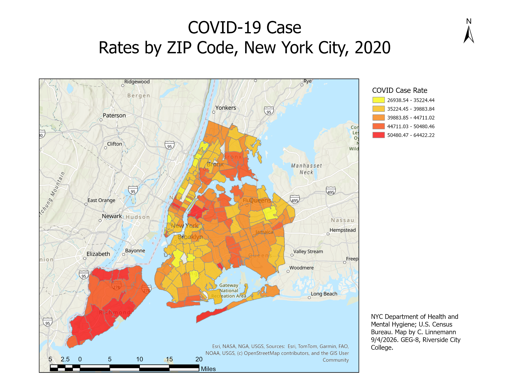
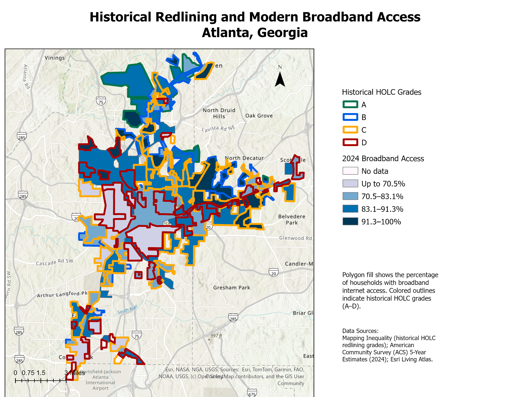

Christian Linnemann

GIS Portfolio | GEG-8 Introduction to GIS

Welcome to my Geographic Information Systems (GIS) portfolio. I am studying GIS at Riverside City College and developing skills in spatial analysis, geographic data interpretation, and cartographic design.

This portfolio showcases two projects completed during my GIS coursework. Each map demonstrates how geographic information can be used to identify spatial patterns, communicate complex data, and better understand issues affecting communities.

Portfolio Projects

Map 1: COVID-19 Case Rates by ZIP Code — New York City, 2020

Question: How did reported COVID-19 case rates vary geographically across New York City ZIP codes in 2020?

Data: This map uses COVID-19 case-rate information from the New York City Department of Health and Mental Hygiene and geographic boundary information from the U.S. Census Bureau. The map represents COVID-19 case rates by ZIP code for 2020.

Method: I used ArcGIS Pro to create a thematic map showing geographic differences in COVID-19 case rates across New York City. I displayed ZIP code areas as polygons and classified the case-rate values into five categories. I then applied a graduated color scheme and created a layout containing a title, legend, north arrow, scale bar, and data source information.

A design choice I made and why: I selected a color progression from yellow to red to make differences in reported case rates easy to recognize. Yellow represents areas with lower rates, while red represents areas with higher rates. This approach helps viewers identify geographic patterns without having to examine individual numerical values for every ZIP code.

A limitation of this map: The map represents reported case rates for a specific period in 2020 and does not explain why rates differed between neighborhoods. Factors such as testing availability, population characteristics, and reporting practices may influence the data. Additionally, ZIP code averages can hide important differences within individual neighborhoods.

Map 2: Historical Redlining and Modern Broadband Access — Atlanta, Georgia

Question: How do historical redlining classifications compare with modern broadband internet access across Atlanta, Georgia?

Data: This map uses historical Home Owners' Loan Corporation (HOLC) neighborhood classifications available through the Mapping Inequality project. Modern broadband access data comes from the American Community Survey (ACS) 2024 five-year estimates, accessed through Esri Living Atlas.

Method: I used ArcGIS Pro to display historical HOLC neighborhood boundaries alongside modern broadband access data for Atlanta. The historical classifications were represented by colored polygon outlines, while broadband access was displayed using shaded polygons showing the percentage of households with broadband internet. I organized the broadband percentages into categories and created a layout with a legend, scale bar, north arrow, and data source information.

A design choice I made and why: I used four distinct outline colors to represent the historical HOLC grades (A through D) and shades of blue to represent broadband access. This allows viewers to compare historical neighborhood classifications with modern internet access without confusing the two datasets. The darker blue shading represents areas with higher percentages of broadband access.

A limitation of this map: The historical redlining data and modern broadband data represent different periods and geographic boundaries. Although the map allows viewers to compare spatial patterns, it cannot establish that historical redlining directly caused present-day differences in broadband access.

Data Sources

Map 1 — COVID-19 Case Rates by ZIP Code, New York City (2020)

New York City Department of Health and Mental Hygiene. (2020). COVID-19 data. NYC Health COVID-19 data repository.

U.S. Census Bureau. Geographic boundary data. Census TIGER/Line Shapefiles.

Map 2 — Historical Redlining and Modern Broadband Access, Atlanta, Georgia

University of Richmond, Digital Scholarship Lab. Mapping Inequality: Redlining in New Deal America. Mapping Inequality.

U.S. Census Bureau. (2024). American Community Survey, five-year estimates: Broadband internet access. American Community Survey.

Esri. Living Atlas of the World. ArcGIS Living Atlas.

Where This Is Going

As I continue studying GIS, I plan to expand this portfolio with additional mapping and spatial analysis projects. My goal is to strengthen my ability to use geographic data to support informed decisions and communicate information clearly.
